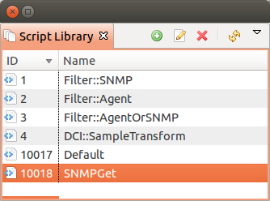
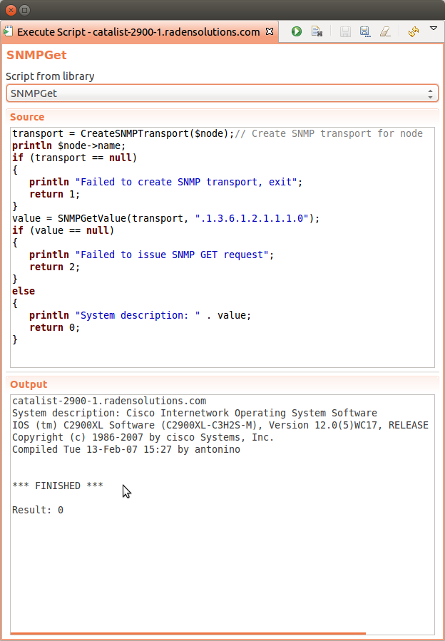

.. _scripting:

#########
Scripting
#########

NXSL
====

Overview
--------

In many parts of the system, fine tuning can be done by using |product_name| built-in
scripting language called NXSL (stands for |product_name| Scripting Language). NXSL was
designed specifically to be used as embedded scripting language within |product_name|,
and because of this has some specific features and limitations. Most notable is
very limited access to data outside script boundaries - for example, from NXSL
script you cannot access files on server, nor call external programs, nor even
access data of the node object other than script is running for without
explicit permission. NXSL is interpreted language - scripts first compiled into
internal representation (similar to byte code in Java), which is then executed
inside NXSL Virtual Machine. Language syntax and available functions can be
found in `NXSL documentation <https://www.netxms.org/documentation/nxsl-latest/>`_.

List of places where NXSL scripting is used
~~~~~~~~~~~~~~~~~~~~~~~~~~~~~~~~~~~~~~~~~~~

  - Script library
  - DCI transformation scripts
  - DCI instance filter script
  - DCI scripted threshold
  - DCI summary table object filter script
  - Container, template, cluster auto-bind script
  - SNMP trap transformation script
  - EPP filter script
  - EPP inline script actions
  - Map object filter script
  - Map link styling script
  - Dashboard scripted chart
  - Dashboard status indicator
  - Context dashboard auto-bind script
  - Business service scripted check
  - Business service DCI auto apply script
  - Business service object auto apply script  
  - Business service prototype instance filter script
  - Asset attribute auto fill script
  - Object query
  - Agent configuration filter script
  - Condition status calculation script
  - Custom housekeeping scripts (see :ref:`custom-housekeeping-scripts`)

.. _script-write-access-restrictions:

Write access restrictions
-------------------------

.. versionadded:: 6.2

Scripts that the server evaluates on its own — transformation, filter, predicate,
and analysis scripts — run with a read-only security context and cannot change
anything in the system. This is controlled by the server configuration parameter
``Scripts.RestrictWriteAccess``, which is enabled by default both on new
installations and after an upgrade from an earlier version.

Such scripts are allowed to read object properties, alarms, agent data, and SNMP
data. Every other operation is denied, including:

  - object modification methods, such as ``setCustomAttribute()``,
    ``deleteCustomAttribute()``, ``setComments()``, ``setAlias()``, ``rename()``,
    ``manage()``, ``unmanage()``, ``enterMaintenance()``, ``leaveMaintenance()``,
    ``bind()``, ``unbind()``, ``createNode()``, ``createContainer()``,
    ``setGeoLocation()``, ``setExpectedState()``, and the ``enable*()`` family;
  - active operations on nodes, such as ``executeAgentCommand()``,
    ``executeSSHCommand()``, ``openSSHSession()``, ``wakeUp()``, and forced polls;
  - functions that require system access rights, such as ``PostEvent()``,
    ``PostEventEx()``, ``SendNotification()``, ``SendMail()``, ``SQLQuery()``,
    ``GetConfigurationVariable()``, ``LoadEvent()``,
    ``CreateUserAgentNotification()``, and ``CancelScheduledTasksByKey()``.

.. warning::
   A denied operation does not raise a script error. The call simply returns
   ``false`` (or a null value, or the supplied default value in case of
   ``GetConfigurationVariable()``), the script continues, and nothing is written
   to the server log at default logging levels. The only trace is a message
   produced by the debug tag ``nxsl.security`` at level 7. If a script that
   worked before an upgrade to 6.2 silently stopped having any effect, this is
   the first thing to check. Scripts started by a user are denied the same
   silent way when the user lacks the required access rights, see
   :ref:`script-user-security-context`.

The following scripts are restricted:

  - DCI transformation script (both single-value and table DCIs)
  - DCI scripted threshold
  - DCI with :guilabel:`Script` origin
  - ``script:`` macro in DCI text expansion and ``%[script]`` macro in object
    text expansion
  - Container, collector, template, and cluster auto-bind and auto-apply filter
    scripts
  - Condition status calculation script
  - Business service scripted check
  - Business service prototype instance discovery script and instance filter
    script
  - EPP filter script
  - Root cause analysis script (both when an alarm is created by EPP and during
    background re-evaluation)
  - Asset attribute auto fill script
  - Map object filter script, map link styling script, and map link color
    provider script
  - SNMP trap transformation script

The following scripts are not restricted and can still modify objects even when
``Scripts.RestrictWriteAccess`` is enabled:

  - EPP action of type :guilabel:`Execute NXSL script`
  - Hook scripts (script library entries named ``Hook::*``)
  - Scripts executed by scheduled tasks
  - Object tools of type :guilabel:`Server Script`, limited by the access rights
    of the user who runs the tool (see :ref:`script-user-security-context`)
  - Scripts executed manually from the :guilabel:`Execute Server Script` view,
    limited by the access rights of the user who runs the script (see
    :ref:`script-user-security-context`)
  - Scripts executed from the server debug console
  - DCI instance discovery filter script

If a restricted script has to modify objects, the recommended approach is to move
the modifying part into one of the unrestricted script types listed above — for
example, have the DCI generate an event and perform the modification from an EPP
:guilabel:`Execute NXSL script` action.

Alternatively, the restriction can be turned off completely by setting
``Scripts.RestrictWriteAccess`` to ``false`` in :menuselection:`Configuration -->
Server Configuration`. The change takes effect immediately, without a server
restart. Note that changing the value directly in the ``config`` database table
bypasses the change notification and does require a server restart.

.. note::
   If the ``Scripts.RestrictWriteAccess`` row is missing from the configuration
   altogether, the server treats the restriction as enabled.

.. _script-user-security-context:

Scripts started by a user
~~~~~~~~~~~~~~~~~~~~~~~~~

.. versionadded:: 6.1

Scripts started by a user run with that user's security context, regardless of
the ``Scripts.RestrictWriteAccess`` setting. This applies to:

  - object tools of type :guilabel:`Server Script`;
  - scripts executed from the :guilabel:`Execute Server Script` view;
  - dashboard scripted chart elements.

Such a script can access or modify an object only if the user has the access
right that the operation requires on that object. For example,
``setCustomAttribute()`` requires the :guilabel:`Modify` access right on the
object. Functions that require system access rights, such as ``SQLQuery()`` or
``GetConfigurationVariable()``, are allowed only if the user has the
corresponding system access right.

.. warning::
   A call denied by the user's security context behaves the same way as one
   denied by the read-only context: it returns ``false`` (or a null value, or
   the supplied default value in case of ``GetConfigurationVariable()``), no
   script error is raised, and the script continues. Object access denials are
   logged by the debug tag ``nxsl.security`` at level 4. Denials of system
   access rights are not logged at all.

Scripting library
-----------------

:guilabel:`Script Library` is used to store scripts that can be afterwards executed as macros,
part of other script or from debug server console. Scripts can be added, deleted and modified in
in this view.

Usage
~~~~~

Scripts from Script Library can be accessed as:
  1. a macros %[\ `scriptName`\ ]
  2. used in action of type "Execute NXSL script"
  3. executed from DCIs with "Script" source
  4. functions can be called from other scripts either by using "import
     `scriptName`\ " and calling functions by name, or without import, by
     calling "\ `scriptName`::`functionName`\ "
  5. executed from server debug console "execute `scriptName`\ "
  6. scripts having name starting with "`Hook::`\ " are executed automatically,
     e.g. "Hook::ConfigurationPoll" is being run on each node's configuration
     poll

.. note::
   All parameters provided to script are accessible via $ARGS array. The other 
   option to use parameters is to specify `main()` function in the script and 
   define parameters in it's definition. 

.. _execute_server_script:

Execute Server Script
---------------------

This view allows to execute arbitrary script. Script can be manually created just before execution,
and saved afterwards, can be taken from the script library or modified script can be used from the
script library and saved or saved as afterwards. If this view is opened on a node, then in the
script ``$node`` variable is available with node object.
All parameters provided to script, like $node, $object, $isCluster, $ARGV, etc, are accessible via $ARGS array. Please refer to `NXSL Guide <https://netxms.org/documentation/nxsl-latest/>`_ for more information.
   

NXShell
=======

NXShell is based on Jython and provide access to |product_name| Java API using interactive
shell. NXShell binary comes with server distribution suite and can be run from shell or crontab. NXShell is also build as single jar file, which includes all required libraries.

Download: http://www.netxms.org/download/nxshell-VERSION.jar
(example: http://www.netxms.org/download/nxshell-5.0.8.jar)

Usage 
-----

NXShell binary gets installed in $NETXMS_HOME directory, for example /usr/bin/nxshell.
As of version 5.1, nxshell launcher accepts command line -r or --properties= for providing path to 
nxshell properties file.

Usage: ``nxshell [OPTIONS] [script]``

Options:
  -C, --classpath <path>      Additional Java class path.
  -D, --debug                 Show additional debug output (use twice for extra output).
  -h, --help                  Display this help message.
  -H, --host <hostname>       Specify host name or IP address. Could be in host:port form.
  -j, --jre <path>            Specify JRE location.
  -n, --no-sync               Do not synchronize objects on connect.
  -p, --port <port>           Specify TCP port for connection. Default is 4701.
  -P, --password <password>   Specify user's password. Default is empty.
  -r, --properties <file>	    File with additional Java properties.
  -t, --token <token>         Login to server using given authentication token.
  -u, --user <user>           Login to server as user. Default is "admin".
  -v, --version               Display version information.

There are two options of this jar usage:

  1. it can be started as interactive shell:

    .. code-block:: sh

     java -jar nxshell-5.0.8.jar

  2. it can be started with the script name as a first parameter. Then it will just
     execute this script and exit. Example:

    .. code-block:: sh

     java -jar nxshell-5.0.8.jar test.py

When NXShell is started, it tries to get server IP, login and password from Java
properties. In interactive mode, user will be asked for details, otherwise
default values will be used.

Start as interactive shell, with IP and Login provided (password will be asked):

    .. code-block:: sh

      java -Dnetxms.server=127.0.0.1 -Dnetxms.login=admin -jar nxshell-5.0.8.jar

Properties
~~~~~~~~~~

These properties should be set with JVM's "-D" option. Please make sure that all
"-D" options are before "-jar".

======================= ================
Parameter               Default Value
======================= ================
netxms.server           127.0.0.1
netxms.login            admin
netxms.password         netxms
netxms.encryptSession   true
======================= ================

Scripting
---------

For details on API please refer to javadoc at
http://www.netxms.org/documentation/javadoc/latest/.

NXShell provide user with already connected and synchronized session to simplify
scripting. Most required packages are imported as well to minimize typing.

Global Variables
~~~~~~~~~~~~~~~~

=============== ================================ =====================
Variable        Type                             Notes
=============== ================================ =====================
session         org.netxms.client.NXCSession
s               org.netxms.client.NXCSession     Alias for "session"
=============== ================================ =====================

Helper Functions
~~~~~~~~~~~~~~~~

Example
~~~~~~~

More examples can be found on a
`NetXMS wiki <https://wiki.netxms.org/wiki/Using_nxshell_to_automate_bulk_operations>`_.

.. code-block:: python

  parentId = objects.GenericObject.SERVICEROOT # Infrastructure Services root
  cd = NXCObjectCreationData(objects.GenericObject.OBJECT_CONTAINER, "Sample Container", parentId);
  containerId = session.createObject(cd) # createObject return ID of newly created object
  print '"Sample Container" created, id=%d' % (containerId, )

  flags = NXCObjectCreationData.CF_DISABLE_ICMP | \
          NXCObjectCreationData.CF_DISABLE_NXCP | \
          NXCObjectCreationData.CF_DISABLE_SNMP
  for i in xrange(0, 5):
      name = "Node %d" % (i + 1, )
      cd = NXCObjectCreationData(objects.GenericObject.OBJECT_NODE, name, containerId);
      cd.setCreationFlags(flags);
      cd.setPrimaryName("0.0.0.0") # Create node without IP address
      nodeId = session.createObject(cd)
      print '"%s" created, id=%d' % (name, nodeId)
